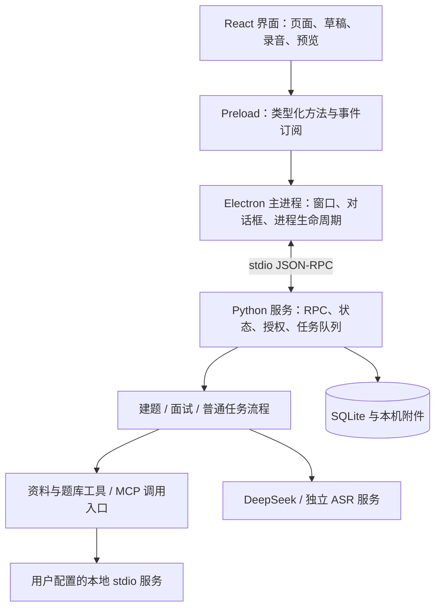

# 知序 · 个人 AI 工作台技术方案 v1.0

日期：2026-10-18（Asia/Shanghai）  
状态：技术方案编写完成，作为正式工程的设计基线；本文方案尚未实现或通过真实服务验收。  
适用范围：Windows 个人桌面应用 P0；按 M1 建题、M2 文字面试、M3 语音与工具交付，M4 课程学习另行扩展。

需求依据：[PRD v1.0](../product/prd-ai-workbench-v1.md)、[UI 交互设计](../product/2026-10-18-workbench-ui-design.md)、[设计与实现差距](../product/2026-10-18-design-coverage.md)。产品行为以 PRD 为准，接口、存储与执行规则以本文为工程基线；本文新增的参数属于技术默认，不代表用户逐项批准。

## 1. 结论与技术决策

采用 **Electron + React/TypeScript + Python 本地服务 + SQLite**。桌面通过受限 IPC 连接 Python，主进程与 Python 之间只使用 stdio JSON-RPC；Python 承担资料范围、任务状态、模型调用、工具校验和数据事务。

这条路线能延续已确认的网页式布局，让面试流程和后续学习 Agent 在 Python 中开发，适合当前学习方向。代价是需要维护 Node 与 Python 两套构建，以及桌面壳的资源开销；M1 首先验证安装包与内存表现，不以框架选定代替实测。

### 1.1 路线比较

| 路线 | 适用性与代价 | 决定 |
| --- | --- | --- |
| Electron + React + Python | 方便实现现有复杂界面，Python 业务独立测试；有双运行时和打包成本 | **推荐并作为本方案基线** |
| PySide6 原生界面 + Python | 单语言业务直接，需重新实现网页式页面；嵌 WebEngine 又增加桥接与录音适配 | 不作为首版路线 |
| Tauri + React + Python | 壳可较轻，但多一层 Rust/系统 WebView，仍要管理 Python 子进程 | 暂不引入第三种语言 |

### 1.2 技术栈与版本口径

下列是 2026-10-18 查询官方资料后的建议基线，不是已安装或已联调版本。工程初始化时生成并提交精确锁文件，安装包记录实际版本，升级后运行关键回归。

| 层 | 基线 | 选择理由及版本规则 |
| --- | --- | --- |
| 桌面 | Electron 44.9.0 起点；Electron Forge | 官方发行页当日列出 44.9.0 稳定版；初始化及发行时选受支持的安全补丁版本，不用 beta/nightly。[发行记录](https://releases.electronjs.org/) |
| 界面 | React 19.3 系列、TypeScript、Vite | React 官方当前文档为 19.3；CSS 沿用原型视觉变量，按页面拆组件。[React 版本](https://react.dev/versions) |
| 构建环境 | Node.js 24 LTS 系列、npm | Node 构建运行时与 Electron 内置 Node 分开记录；Vite 当前要求 Node 20.19+ 或 22.12+，初始化核验选定组合。[Node 发布线](https://nodejs.org/en/about/previous-releases)、[Vite 要求](https://vite.dev/guide/) |
| 本地业务 | CPython 3.14 系列、asyncio | 官方仍处于 bugfix 维护期；暂不追刚发布的 3.15。Windows x64 打包与依赖 wheel 是初始化验证项。[Python 生命周期](https://devguide.python.org/versions/) |
| 数据 | Python sqlite3、顺序 SQL 迁移 | 不加 ORM、远端数据库或 Redis；只由 Python 写数据库。[sqlite3 文档](https://docs.python.org/3.14/library/sqlite3.html) |
| 外部请求 | httpx、Pydantic 2 系列 | 异步 HTTP 与边界校验；不为两个流程先引入 LangChain/LangGraph 或通用编排引擎 |
| 密钥 | keyring + Windows 系统后端 | 数据库只存引用；启动检查后端，禁用明文和空后端降级。[keyring 支持后端](https://keyring.readthedocs.io/en/latest/) |
| Markdown | react-markdown，默认禁用原始 HTML | 不加载远程图片、脚本、iframe；链接交给桌面校验后打开 |
| MCP | 官方 Python SDK 当前稳定 v2 系列 | 只做 stdio 客户端，精确补丁版本通过连接测试后锁定；不混用旧版教程的接口。[官方 SDK](https://github.com/modelcontextprotocol/python-sdk) |
| 测试/打包 | pytest、Playwright、PyInstaller onedir | Windows 构建 Python 可执行目录，再随 Forge 打包；测试含真实进程和临时 SQLite。[PyInstaller](https://pyinstaller.org/en/stable/usage.html)、[Forge Windows 打包](https://www.electronforge.io/config/makers/squirrel.windows) |

首次安装形成 `package-lock.json` 与带哈希的 `requirements.lock`，记录 Python 安装器版本、SQLite 运行时版本和构建架构。没有进行依赖安装的本轮不编造精确锁文件或兼容性结论。

### 1.3 P0 边界

- 单用户、多工作区、一个主窗口；无账号、云端业务服务和团队系统。
- 两个内置流程：面试题整理、AI 面试官。自定义 Agent 走有上限的普通任务流程，不改变内置流程规则。
- 资料、题库、报告、笔记和复习本机持久化；生成、追问和转写依赖云端。
- 不引入向量库、自动电脑控制、学习项目代码执行、插件市场、后台调度、远程 MCP OAuth、实时双向语音。
- 原型 `prototypes/workbench-ui` 保留为设计证据。正式版不直接沿用其中的全局可变状态、示例数据和 localStorage 业务存储；不自动导入演示题库。

## 2. 架构与职责



图中 IPC 是同一条桌面通信链的两段：renderer → main 使用 Electron IPC；main → Python 使用 stdio。P0 不再启动 FastAPI、HTTP/WebSocket 监听端口。

### 2.1 模块所有权

| 模块 | 拥有的职责 | 不得跨越的边界 |
| --- | --- | --- |
| React renderer | 路由、表单、临时编辑、录音按钮、状态展示、受限 Markdown | 不直接访问文件、数据库、进程和供应商密钥 |
| Preload | 固定方法封装、DTO 校验、取消订阅 | 不透传任意 IPC 通道、任意 SQL 或 Shell |
| Electron main | 单实例、文件选择、路径授权登记、外链/麦克风权限、启动/停止 Python | 不维护面试业务状态或直接写题库 |
| Python RPC/application | 命令校验、任务排队、状态机、幂等、来源快照、授权交集 | UI/提示词不能直接指定最终状态 |
| flows | 各流程下一步判断、上下文组装、模型结果落草稿 | 不能绕过工具授权或直接把候选写成正式题 |
| storage | SQL 事务、版本、附件元数据、迁移备份 | 网络等待不持有写事务；禁止硬删除仍被历史引用的版本 |
| providers/tools | 有超时的外部调用、来源读取、MCP 会话 | 只返回数据，最终提交由 application 再校验执行代次 |

业务对象使用普通 Python 模块和函数，不额外套一层通用 Repository、依赖注入容器或插件框架。只有供应商和工具边界保留小接口，便于可控测试替身替换。

### 2.2 建议工程目录

以下目录尚未创建，首次工程实施再落地：

```text
apps/desktop/
  src/main/                 # desktop lifecycle and platform boundaries
  src/preload/              # typed bridge
  src/renderer/             # pages, components, local editing state
services/workbench/
  src/workbench/
    rpc.py                  # framing and dispatch
    tasks.py                # queue, transitions, cancellation
    materials.py            # scope, snapshots, source locators
    questions.py            # candidates, deduplication, versions
    interviews.py           # turns, hints, feedback
    reviews.py              # recall attempts
    artifacts.py            # revisions, reports, export
    storage.py              # transactions and migrations
    providers/              # deepseek, asr
    tools/                  # built-ins, mcp, policy
  migrations/
  tests/
contracts/                  # JSON Schema exported from Python DTOs
tests/e2e/                  # desktop flows and controlled providers
scripts/                    # Windows build and verification
```

Python Pydantic DTO 是业务契约来源，导出 JSON Schema 后生成 TypeScript 类型；协议版本不兼容时启动失败并提示更新应用。表单校验提高体验，Python 始终再次校验。

### 2.3 启动、退出与崩溃

1. 主进程取得单实例锁，建立 `app://workbench` 本地页面来源；第二次启动聚焦已有窗口。
2. 使用 `spawn(executable, args, {shell:false, windowsHide:true, stdio:['pipe','pipe','pipe']})` 启动打包的 Python。开发态使用明确解释器的 `-u -m workbench`，不依赖全局 PATH；打包态保留标准流，不用 PyInstaller `--noconsole` 破坏通信。
3. Python 执行迁移/恢复检查，通过 `system.initialize` 返回 `protocol_version`、`schema_version`、`service_instance_id` 和可用能力。15 秒未就绪显示失败，可重试启动；迁移中展示步骤，不无限显示空白页。
4. UI 就绪后读取快照及事件水位，再开始接收事件；未就绪时可保留前端未保存输入，但不显示“已保存”。
5. 正常退出先刷新草稿，停止录音和入队，要求服务取消执行、关闭 MCP、提交数据库并退出；超过 5 秒进入可见的强制退出分支。只终止本应用持有句柄的进程，不按名称批量杀 Python/Node。
6. 主进程关闭导致管道 EOF 时 Python 执行同样的清理；Windows 子进程树用本应用的 Job Object 管理并在打包验证中测试，不能把 `kill()` 根 PID 当作子孙进程一定退出。stdio 启动和隐藏窗口行为依据 [Node 子进程文档](https://nodejs.org/api/child_process.html)。
7. Python 意外退出：UI 立即断开保存/执行操作，保留编辑缓冲；用户触发重启后重新握手并拉取数据库快照。业务请求不会自动重发。

## 3. 桌面与本地服务契约

### 3.1 消息与传输

- JSON-RPC 2.0，每行一个完整 UTF-8 JSON，以 LF 分隔；字符串换行用 JSON 转义。stdout 只输出协议，stderr 输出脱敏诊断；不记录请求全文。
- `id` 是本次 RPC 请求标识，`operation_id` 是跨超时重试保持不变的业务幂等标识，两者不可混用。ID 用 UUID；文中短 ID 仅便于阅读。
- 单帧上限 8 MiB，非法编码/帧长度直接拒绝。列表默认 50、上限 200；材料和音频不放进任务事件。音频块上限 256 KiB，通过顺序号与确认控制积压。
- RPC 普通命令 10 秒内返回；AI 命令先持久化排队再返回 task ID，结果由事件/查询取得。超时表示确认结果不明，按原 `operation_id` 查询，不能直接重复执行。
- 双向读写持续运行，长任务放入 asyncio task；写标准流经单一队列。文件 I/O 与数据库串行工作放在线程执行器，不能卡住取消、草稿或心跳。
- `system.ping` 每 5 秒一次，连续 3 次无响应显示本地服务异常；不以重启服务替代对存储失败的处理。

示例：提交一个建题任务。`scope` 使用已经读入且经用户选择的版本 ID，不由 UI 直接传任意文件路径：

```json
{
  "jsonrpc": "2.0",
  "id": "rpc-101",
  "method": "tasks.create",
  "params": {
    "operation_id": "op-create-101",
    "task_type": "question_generation",
    "workspace_id": "ws-java",
    "agent_config_version_id": "agent-question-v1",
    "material_version_ids": ["mat-v7"],
    "input": {"role": "java_backend", "topics": ["concurrency"], "count": 10}
  }
}
```

### 3.2 命令清单

下列是业务方法组，写方法统一传 `operation_id`，修改可变对象还传 `expected_revision`；创建时无 revision。每个读取都校验对象所在空间与当前范围。

| 方法组 | 主要方法 | 契约要点 |
| --- | --- | --- |
| 系统/数据 | `system.initialize/ping/shutdown`、`data.backup/restore/delete` | 恢复/删除需要具体范围确认，暂停执行后进行 |
| 工作区 | `workspaces.list/create/update/archive/linkDirectory/unlinkDirectory` | 目录选择只经 main 对话框，返回不可伪造的选择凭据；移除关联不删原目录 |
| 资料 | `materials.list/importText/importFiles/preview/checkFreshness/archive` | 文件导入验证目录凭据；返回不可变版本，预览不等于选入任务 |
| 草稿 | `drafts.get/save` | 返回服务 revision 与保存时间；拒绝覆盖更高 revision |
| 配置 | `providers.list/update/test/setSecret/deleteSecret`、`agents.list/saveVersion` | 不返回密钥；非敏感配置版本化，更新只影响新任务 |
| 任务 | `tasks.create/get/list/cancel/resume/continue`、`events.list`、`operations.get` | 恢复显式，`continue` 只接受当前 waiting reason 对应命令 |
| 候选/题库 | `candidates.update/validate/commit`、`questions.list/get/update/archive/export` | commit 显式选择 ID、编辑版本及新增/更新决策 |
| 面试 | `interviews.create/get/activate/submitAnswer/addCorrection/requestHint/skip/finish` | 校验活动面试、当前轮次、模式及答案提交版本 |
| 报告/成果 | `reports.get/list/regenerate/saveNote/export`、`artifacts.saveRevision/compare/handoff` | 重生成与手工笔记分离；handoff 创建材料快照与新任务 |
| 复习 | `reviews.add/remove/list/start/revealReference/saveAttempt` | 服务先持久化 reference_seen，再返回参考内容 |
| 语音附件 | `audio.begin/append/finish/discard/transcribe`、`attachments.delete` | 本机保存与云转写分开；删音频不级联删已确认回答 |
| MCP/工具 | `mcp.configure/connect/disconnect/listTools`、`tools.setPolicy/approve/call/getCall` | 配置变化失效旧连接与授权；工具调用走同一权限入口 |

main 单独提供 `chooseDirectory/chooseFiles/chooseExportTarget/openExternal` 平台方法。目录/导出凭据在 Python 内通过仅主进程可发的内部方法登记，再交给业务命令使用；renderer 无权调用该登记方法。凭据绑定用户选中的规范路径、动作、有效期，不因 UI 传入另一个字符串扩大范围。

### 3.3 事件与重放

```json
{
  "jsonrpc": "2.0",
  "method": "task.event",
  "params": {
    "event_id": "evt-16",
    "task_id": "task-101",
    "seq": 16,
    "run_id": "run-2",
    "service_instance_id": "svc-8",
    "task_revision": 9,
    "type": "task.waiting_user",
    "payload": {"reason": "review_candidates", "candidate_batch_id": "batch-3"}
  }
}
```

持久事件：`task.status_changed`、`step.started/completed/failed`、`task.waiting_user`、`candidates.ready`、`answer.committed`、`feedback.ready`、`report.ready`、`artifact.revision_created`、`tool.status_changed`。只展示事实、输入范围、处理摘要与结果，不输出内部思维链。

每个任务 `seq` 单调递增且唯一，业务写入与对应事件在同一事务。事件提交后才推送；若推送丢失，`tasks.get` 返回带 `last_seq` 的快照，随后 `events.list(after_seq)` 补齐，客户端按 seq 去重。快照与补齐之间发生的事件仍能查询，不靠订阅时机保证不丢消息。

流式正文只作临时预览，不逐 token 写 SQLite。每条临时 delta 含 `run_id/stream_id/chunk_index`，断线后清除未完成预览，以服务已提交快照为准；最终完整内容校验后才生成候选、反馈或成果版本。旧服务实例的推送不接收，但历史持久事件仍可通过查询重放。

### 3.4 错误结构

业务错误放在 JSON-RPC `error.data` 中：`code / user_message / retryable / task_id / step / operation_id / committed / recovery_action`。协议错误沿用 JSON-RPC 标准错误码；用户界面展示可读原因，不直接展示供应商整段响应。

| 业务码 | 行为 |
| --- | --- |
| `PROVIDER_NOT_CONFIGURED / AUTH_FAILED / RATE_LIMITED` | 保留输入，给出配置或稍后重试入口 |
| `CONTEXT_TOO_LARGE / SOURCE_OUT_OF_SCOPE / SOURCE_CHANGED` | 请求发出前阻断，返回可定位的材料问题 |
| `MODEL_EMPTY / MODEL_TRUNCATED / MODEL_SCHEMA_INVALID` | 保留候选草稿或原输入，不写题库 |
| `REVISION_CONFLICT / STALE_TURN / STALE_RUN` | 重新取快照并比较，禁止无条件覆盖 |
| `STORAGE_FULL / STORAGE_UNAVAILABLE` | committed=false，保留未保存编辑与复制入口 |
| `TOOL_DENIED / TOOL_TIMEOUT / TOOL_OUTCOME_UNKNOWN` | 不重试有副作用调用，先检查实际结果 |
| `SERVICE_DISCONNECTED / OPERATION_PENDING` | 使用原操作 ID 查询，不能把断线解释为失败回滚 |

## 4. 持久化与版本模型

### 4.1 数据目录与通用约定

生产数据根目录由主进程的 `app.getPath('userData')` 获取，产品固定名 `ZhixuWorkbench`；常见路径为 `%APPDATA%\ZhixuWorkbench`，以运行时返回值为准。安装目录、项目源码目录和业务数据目录分开。

```text
<userData>/
  data/workbench.sqlite3
  attachments/<uuid>.<validated-extension>
  backups/<timestamp>/              # snapshot, manifest, selected attachments
  logs/                            # redacted rotation logs
  tmp/                             # unfinished attachments/exports
```

所有业务实体主键为 UUID TEXT，单例和迁移版本除外；实体带 created_at，时间为 UTC ISO 8601，界面按 Asia/Shanghai 显示。可变对象含 `revision`；材料、题目、Agent、报告、成果的版本只新增。JSON 列保存不含凭据的业务快照，写入前 Pydantic 校验，数据库加 `json_valid` 检查；不把原始模型输出等同业务对象。

每个连接启用 `foreign_keys=ON`；主库启用 WAL、`synchronous=FULL`、`busy_timeout=5000`。一个串行数据库工作线程拥有写连接，读请求用短生命周期只读连接；事务中不等待模型/工具。P0 先使用参数化 SQL，不跨线程共享同一连接。

### 4.2 表与关键字段

下表定义首版持久化对象；`*_json` 为校验后的结构，所有 version 表有 `created_at`，所有 mutable 表另有 `updated_at/revision`。历史引用默认 `ON DELETE RESTRICT`。

| 表 | 关键字段 | 约束或用途 |
| --- | --- | --- |
| `schema_migrations` | version PK、checksum、applied_at | 迁移内容改变必须另加版本 |
| `workspaces` | id、name、role_tags_json、archived_at | 多空间独立，归档不删资料 |
| `directory_links` | id、workspace_id FK、canonical_root、linked_at、removed_at | 原项目只读；link 不代表读过全部文件 |
| `materials` | id、workspace_id FK nullable、kind、display_name、archived_at | 无空间粘贴内容绑定其任务，不可全局枚举 |
| `material_versions` | id、material_id FK、version_no、content_text、sha256、source_json、read_at | UNIQUE(material_id,version_no)，真实内容和定位不可变 |
| `provider_configs` | id、kind、current_version_id | kind 为 text/asr |
| `provider_config_versions` | id、provider_id FK、version_no、endpoint、model_id、parameters_json、secret_ref | UNIQUE(provider_id,version_no)，不存密钥值 |
| `agent_configs` / `agent_config_versions` | id、agent_id FK、version_no、flow_type、instructions、provider_version_id、allowed_tools_json | flow_type 内置值不可由自定义提示词覆盖 |
| `tasks` | id、workspace_id nullable、type、status、waiting_reason、agent_version_id、input_snapshot_json、scope_snapshot_json、checkpoint_json、active_run_id | revision 保护状态；参数/材料版本绑定任务 |
| `task_runs` | id、task_id FK、attempt_no、state、started_at、ended_at、error_json | UNIQUE(task_id,attempt_no)，每次重试新 run |
| `task_events` | event_id PK、task_id FK、seq、run_id nullable、task_revision、type、payload_json | UNIQUE(task_id,seq)，与状态同事务 |
| `operations` | operation_id PK、method、scope_id、request_hash、status、result_json、error_json | 相同 ID 不同规范化请求返回冲突，保留业务对象存续期 |
| `candidate_batches` | id、task_id FK、run_id FK、items_json、validation_json、source_snapshot_json | 条目各有 candidate_id/revision，先草稿后提交 |
| `questions` | id、workspace_id nullable、current_version_id、normalized_title_hash、archived_at | hash 建普通索引，显式允许保留不同角度的重复题 |
| `question_versions` | id、question_id FK、version_no、body_json、provenance_json、edit_origin | UNIQUE(question_id,version_no)，旧面试固定引用 |
| `question_search` | question_id PK/FK、workspace_id、search_text | 当前版本检索投影，不承担历史真值 |
| `candidate_commits` | batch_id FK、candidate_id、question_id FK、question_version_id FK、operation_id FK | UNIQUE(batch_id,candidate_id)，跨操作 ID 重复保存仍不新增题 |
| `interviews` | id、task_id FK、workspace_id nullable、mode、phase、settings_json、question_plan_json、current_turn_id、ended_at | 题目计划固定版本 ID；是否活动由 app_state 记录 |
| `interview_turns` | id、interview_id FK、main_index、followup_index、kind、question_version_id nullable、question_snapshot_json、basis_json、status | UNIQUE(interview_id,main_index,followup_index)，kind=main/followup |
| `answers` | id、turn_id FK UNIQUE、operation_id FK、answer_text、answer_kind、input_mode、hint_snapshot_json、attachment_id nullable、submitted_at | answer_kind=answered/skipped/unknown；已提交原文不覆盖 |
| `answer_corrections` | id、answer_id FK、text、created_at | 更正追加，旧反馈引用版本可解释 |
| `hint_events` | id、turn_id FK、level、content、revealed_at | 先记提示使用再显示内容；不因重开消失 |
| `feedback_versions` | id、interview_id FK、main_index、version_no、input_snapshot_json、claims_json、status | 引用回答/更正集合；不储存强制总分 |
| `report_versions` | id、interview_id FK、version_no、answer_snapshot_json、feedback_version_ids_json、content_json | UNIQUE(interview_id,version_no)，旧报告不可变 |
| `notes` | id、owner_type、owner_id、content_md | 报告/题目/工作区的用户笔记独立保存 |
| `artifacts` / `artifact_versions` | artifact_id、version_no、task_id、base_version_id、content_md、origin、saved_at | origin=model/user；新稿不覆盖用户保存版本 |
| `review_items` | id、question_id FK UNIQUE、source_refs_json、removed_at | 报告多次加入同一题合并来源，可重新启用 |
| `review_attempts` | id、review_id FK、question_version_id FK、draft_text、reference_seen_at、self_assessment、completed_at | 每项最多一个未完成 attempt；reference_seen_at 只能由 null 变为时间 |
| `attachments` | id、owner_type、owner_id、relative_path、mime、size_bytes、sha256、state、deleted_at | 路径由服务生成；上传中/可用/删除中/已删除有区别 |
| `drafts` | id、owner_type、owner_id、content_json、saved_at | UNIQUE(owner_type,owner_id)，revision 防乱序覆盖 |
| `mcp_servers` / `tool_policies` | server_id、executable、args_json、env_refs_json、config_revision；tool_key、schema_hash、risk、enabled、allowed_roots_json | 工具描述不是可信授权；配置/Schema 变化重新检查 |
| `tool_calls` | id、task_id FK、run_id FK、operation_id FK、tool_key、args_hash、status、effect_class、approval_snapshot_json、result_summary_json | 外部副作用保留 started/unknown 等状态，不能伪称 exactly-once |
| `app_state` | singleton_id=1、active_interview_id nullable、settings_json | 只允许这个面试接收回答，查看旧档案不改指针 |

除显式无空间任务外，服务校验 `workspace_id` 一致性；引用版本属于哪个空间由 join 确认，不能信任前端给的 workspace ID。P0 题库按空间隔离；“全部空间”只聚合本用户记录并展示空间标签，跨空间复制题目须显式创建独立题目和来源快照。

### 4.3 关键事务与索引

1. **候选入库**：先校验请求形状及 batch 所属范围 → 开事务并查询 operations，相同请求已完成则直接返回旧结果 → 新操作先检查 candidate_commits，再对未提交候选校验编辑版本 → 新增题/题目版本或按用户选择更新已有题 → 写映射、结果与事件 → 提交。已提交候选返回原题映射并记 skipped，提交后的编辑必须走题库修订。任一存储错误整批回滚。部分入库由用户选择的子集决定，不靠忽略错误实现。
2. **答案提交**：先校验请求形状与面试归属 → 开事务查询 operations，相同请求已提交则返回原答案确认 → 仅新操作校验活动面试/当前 turn/expected_revision → 同事务写唯一 answers、操作结果、事件并记录下一检查点 → 提交后才请求追问或反馈。后续云调用失败不回滚答案。
3. **反馈、报告和成果**：提交前再次比较 active_run_id、任务 revision/状态与输入快照；只有仍属当前执行的完整结果能新增版本。取消后迟到结果丢弃。
4. **草稿和笔记**：`UPDATE ... WHERE revision=?`，受影响行数为 0 即冲突；成功才给新 revision。前端同一草稿最多一个在途保存，合并后续修改；未确认内容留在编辑缓冲。
5. **复习辅助**：`reviews.revealReference` 先写入 reference_seen_at，事务成功后返回参考；写失败时不展示并允许重试。完成 attempt 后再次练习新建 attempt，不把旧辅助状态清零。

索引至少包含 `questions(workspace_id,archived_at)`、`questions(normalized_title_hash)`、`tasks(status,created_at)`、`task_events(task_id,seq)`、`report_versions(interview_id,version_no)`、`interview_turns(interview_id,main_index,followup_index)`，以及上述 UNIQUE 约束。`review_attempts(review_id) WHERE completed_at IS NULL` 建唯一部分索引。

P0 在当前题目版本的检索投影保存 `search_text`，包含题干、主题、岗位与要点，更新题目同事务更新投影。关键词用参数化 LIKE/INSTR，转义 `%/_`，10000 题测试 P95≤500 ms；索引主要服务空间/归档筛选，普通 B-tree 不承诺加速包含式搜索。未达标时只替换为 SQLite FTS5 trigram 投影，先验证发行 SQLite 是否支持，不提前引入向量库。

### 4.4 备份、恢复与删除

- 迁移前停止接收写命令，使用 SQLite backup API 产生一致快照，不能只复制处于 WAL 模式的主文件。执行顺序迁移、校验 checksum 与 `integrity_check`；失败保留旧备份并停止业务写入。[备份 API](https://docs.python.org/3.14/library/sqlite3.html#sqlite3.Connection.backup)
- 备份清单记录 schema/app/protocol 版本、哈希、附件 ID；全量备份时短暂冻结附件新增/删除后复制所引用附件。迁移备份默认不重复复制未变附件，单独注明不是完整离机备份。
- 手动恢复先显示将替换的工作台数据范围，备份当前库，断开执行/录音/MCP，关闭所有连接，校验恢复包路径与哈希后替换，再启动校验；不能把新 schema 数据交给旧应用直接写。
- 默认保留最近 5 份迁移备份，手动备份不自动清理。密钥不进入备份，换机恢复后重新配置；备份包含笔记和材料正文，不因不含密钥就当作公开文件。
- 普通归档保留历史。用户明确删除本机记录时显示工作区/任务/附件/备份的影响及依赖清单；可选择连带删除或取消，不产生悬空引用。删除仅发生在数据根目录，永不删除关联项目。
- 音频采用删除队列：元数据标删除中 → 删除应用拥有的文件 → 标已删除；失败可重试。答案保留文字与“原音频已删除”状态。清理当前数据不声称清掉供应商留存或用户另存的导出。

## 5. 任务状态、调度、幂等与恢复

### 5.1 任务状态迁移

| 当前状态 | 允许动作/事件 | 目标状态 |
| --- | --- | --- |
| `draft` | 提交 / 放弃 | `queued` / `cancelled` |
| `queued` | 取得执行槽 / 取消 | `running` / `cancelled` |
| `running` | 等待用户 / 完成 / 失败 / 请求取消 / 崩溃 | `waiting_user` / `completed` / `failed` / `cancelling` / `interrupted` |
| `waiting_user` | 用户提交下一动作 / 明确结束 / 取消 | `queued` / `completed` / `cancelled` |
| `cancelling` | 本机执行已停止 / 退出中断 | `cancelled` / `interrupted` |
| `failed` | 用户从检查点重试 / 放弃 | `queued` / `cancelled` |
| `interrupted` | 用户检查后恢复 / 放弃 | `queued` 或 `waiting_user` / `cancelled` |
| `completed` / `cancelled` | 查看、复制为新任务 | 不原地重跑；新请求创建新任务 |

waiting_reason 为 `review_candidates / answer_question / verify_transcript / approve_tool / review_artifact` 等枚举，不靠状态字符串推断具体业务阶段。用户提前结束面试是正常完成，面试结果另记 `finished_early`；取消表示停止任务，不自动生成新报告。

上表的 waiting_user → completed 仅用于无需后续计算的显式收口；面试 finish 若仍需反馈或报告，应先保存 finishing 检查点并进入 queued，报告生成完成后才 completed。面试结束意图已保存时不再接受新回答，报告失败可以重试缺失步骤。

### 5.2 执行槽与检查点

P0 一个主动 AI 执行槽，FIFO 排队；模型、ASR、普通 Agent 工具循环及连接测试均通过同一协调器，不在任务内部再次争抢造成死锁。用户录音、材料预览、SQLite 保存不占该槽。等待检查候选、核对转写、工具授权或作答时释放槽；下一动作重新排队。

每次开始 AI 执行创建新 `task_run`，`active_run_id` 是提交栅栏。检查点只记录已持久化的输入、输出版本和下一个允许动作；不尝试恢复模型内部生成进度或半个工具响应。

检查点例：候选批次已可检查、主问题已展示、答案已提交待判断、追问已保存待回答、主问题反馈已保存、报告已归档、复习 attempt 未完成。等待用户退出后可以直接恢复界面，无需再次调用云端。

### 5.3 取消的原子边界

1. 在数据库事务中把 task 改为 cancelling 并撤销 active_run_id，提交 `cancel_requested` 事件。取消确认从此刻生效。
2. 发出 asyncio cancel，关闭 HTTP 流；对工具发送协议取消/关闭请求，不能中止远端处理时记录实际情况。
3. 所有输出写入前在同一事务读取 task 状态和 active_run_id。失配返回 STALE_RUN，禁止写候选、报告、题库、下一轮问题或覆盖成果。
4. 如果结果提交事务先完成，取消随后到达，则保留已提交结果，取消后续步骤并在 UI 解释先后；取消不撤回已确认答案或已入库题目。
5. 本地执行结束即可显示 cancelled，并显示远端可能继续执行/已产生用量。工具副作用不明单列 unknown，不能以 cancelled 推断外部已撤销。

### 5.4 幂等与崩溃恢复

本机 SQLite 写命令在同一事务内记录 operation 与业务结果。相同 operation_id + 相同 method/scope/request_hash 返回旧结果；不同请求返回冲突。canonical JSON 计算哈希，排除 RPC id，保留影响语义的 revision、选择集和参数。

所有写命令统一按“请求形状与对象访问范围 → 幂等结果查询 → 新操作的当前状态/revision 校验 → 写入”执行。重试保留第一次请求的 expected_revision；即使轮次已前进，已提交操作仍返回当次成功结果，不被新的 STALE_TURN 或 REVISION_CONFLICT 掩盖。幂等查询不绕过对象归属检查，也不允许新请求借用别人的操作 ID。

网络请求先持久化 started，再发请求；供应商调用不具备本应用可证明的 exactly-once。传输断开且结果不明时不自动重发，保留输入并让用户选择重试；本地业务提交仍可用 operation_id 确认。

启动扫描：旧 running/cancelling/queued → interrupted；旧 waiting_user 保留；draft 和终态保留。queued 不自动执行，用户选择恢复后再入队。未完成 tool_call 标 unknown，已提交 answers/candidate_commits/report_versions 不重做；事件确认丢失则返回已提交结果。

重复点击与恢复的稳定标识包括 candidate_id、turn_id、question_version_id、operation_id。用户从取消任务“重新生成”是新任务；不得换一个操作 ID 绕过同一候选或同一轮回答唯一约束。

## 6. 资料读取、来源与上下文预算

### 6.1 文件输入边界

P0 支持粘贴文本、`.md/.txt/.json/.py/.java`，其他源码文本按可配置的文本扩展名白名单扩展。先识别 BOM/UTF-8，解码失败时提供用户指定编码后重新读取，不用静默替换乱码。单文件 200000 字节、本次总量 1000000 字节，按 PRD 的 200 KB/1 MB 产品限制采用十进制计量，界面显示实际大小。

关联目录默认只列元数据；勾选文件并确认后才读取正文、生成 material_version。排除 `.git`、`node_modules`、`.venv/venv`、`__pycache__`、`target/build/dist`、二进制及 `.env*`、私钥、凭据文件；普通文本 `.env.example` 也不自动绕过排除。特殊文件需单独选择、展示风险并确认本次使用，不能靠改扩展名绕过内容检查。

Windows 路径先规范化并解析真实目标，按不区分大小写的路径段比较目录包含关系，不能用字符串 startsWith。P0 拒绝 junction/symlink/reparse point、UNC、设备路径、NTFS 替代数据流；选定根目录和实际读取文件都检查，打开后再次核对解析目标与文件标识。发生替换、越界或读取前后 stat 不一致时拒绝本次快照。原项目永远只读。

用户提供 URL 仅作为来源字段，P0 不自动抓取网页。课程跟写、用户笔记、项目材料、外部核验资料采用独立类型，不能把课程练习标成实际生产经历。

### 6.2 来源快照与过期

material_version 保留完整选定正文、原编码、SHA-256、读取时间、来源类型、原路径/URL、是否来自用户导入。引用采用 `material_version_id + locator`，文本 locator 是起止行和原文摘录哈希；服务从真实快照生成定位，模型只能引用给定 source ID 和范围。

进入新任务前，在目录仍被有效关联的范围内检查原文件可用性、大小/修改时间，必要时重新计算哈希。关联移除后不再自动访问该路径，只能使用已有快照或重新授权关联。变化后显示“使用已保存快照 / 读取新版 / 移除材料”，把选择写入新任务快照。旧题和旧面试保留旧版本；文件消失只影响可用状态，不删历史正文。

题目来源类型为 `model_training / project_derived / user_material / verified_external`。最后一类必须有人工核验记录、URL 和时间；单靠模型返回这个枚举不能升级来源。没有材料的主题建题强制 model_training，不伪造来源；引用不存在或越界的题目不能通过来源校验。

### 6.3 上下文组装

1. 读取任务绑定的版本，构造材料清单、ID、正文与可用行范围；不因项目目录被关联就读取其他文件。
2. 根据任务类型按需要组装系统规则、参数、题目、已确认回答、允许工具和选定材料。向外发送前显示实际材料清单和估计量。
3. 首版设置输入软预算 24000 tokens、输出默认最多 8000 tokens，且不超过供应商当前能力。总预算保留至少 20% 余量，prompt 和工具 schema 也计入；这些是应用限制，不照搬供应商最大上下文。
4. DeepSeek 官方 tokenizer 可用时用于精确预检；否则按 UTF-8 字节数作保守上界估计并标“估计”，运行时核对 usage。超预算让用户缩小材料/选行/分批，不在后台静默截断或用未保存摘要替换正文。
5. 面试上下文只放当前题版本、相关材料、这一主问题的回答/追问/提示及必要的结构化进度；整场报告按主问题分别生成反馈后汇总，避免无限对话历史。
6. 材料、工具输出和回答作为数据区域传入，提示中明确不将其视为授权。权限判断只读取服务保存的范围，模型文本无法要求读取额外文件。

## 7. 模型接入与候选题整理

### 7.1 DeepSeek 适配

使用 `POST https://api.deepseek.com/chat/completions`，首个模型建议 `deepseek-flash`，通过配置更换模型 ID。官方当日列出的模型还包括 `deepseek-v4-pro`；别名对应版本可能更新，任务记录请求 model ID、配置版本及返回的实际 model 信息，不声称云端别名永久可复现。[模型与接口地址](https://api-docs.deepseek.com/quick_start/pricing/)

建题和阶段判断请求 JSON Output：`response_format={"type":"json_object"}`，prompt 给出 JSON 示例；本地还需校验字段、枚举、数量和来源。JSON 模式可能空返回或因长度截断，必须检查 content 与 finish_reason，不能只检查能否 JSON.parse。[JSON 输出说明](https://api-docs.deepseek.com/guides/json_mode/)、[Chat Completions 契约](https://api-docs.deepseek.com/api/create-chat-completion/)

请求默认关闭 thinking，使用 `thinking={"type":"disabled"}`，参数适配以当期官方能力为准；不把内部 reasoning 内容接入执行步骤。[Thinking Mode](https://api-docs.deepseek.com/guides/thinking_mode/) 候选和反馈可非流式返回，普通成果可 SSE 预览；SSE 采用按完整事件组帧的解析器，不能假定一个网络 chunk 就是一条 JSON。

技术默认：connect=10 秒、read idle=60 秒、单次文本总时限=180 秒；收到取消即关闭流。401/403 直接报配置错误；429/5xx 在明确收到错误响应且本次未产出内容时最多自动退避重试 1 次，遵守 Retry-After 并显示状态。未知网络断开、部分内容和超时由用户决定重试；不对有副作用工具套用此策略。

连接测试只请求一个极短固定文本，不含项目内容；返回连接结果、延迟、模型和错误码，用量未知就显示未知。记录 provider request ID、输入/输出用量和耗时；费用仅在有已核验单价时估算，不把缺 usage 当作免费。不设置账号、不购买服务属于本次文档工作的自然边界。

### 7.2 候选 DTO

候选批次包含 `schema_version / requested_count / questions[]`，question 最小结构如下。所有数组长度、字符串长度和枚举在 Pydantic 中限制，不能由模型生成任意数据规模：

```json
{
  "candidate_id": "candidate-1",
  "title": "线程池队列满时如何选择拒绝策略？",
  "topics": ["concurrency", "thread_pool"],
  "roles": ["java_backend"],
  "difficulty": "intermediate",
  "intent": "解释吞吐、延迟和任务完整性之间的取舍",
  "answer_points": ["说明队列、最大线程数与拒绝处理器的触发关系"],
  "acceptable_alternatives": ["根据可丢弃任务或关键任务说明不同处理方式"],
  "followup_directions": ["如何避免调用方被阻塞导致级联故障"],
  "source_type": "model_training",
  "source_refs": [],
  "claims_to_verify": []
}
```

candidate_id 由服务在接收结果时分配，模型提供的 ID 不能覆盖已有候选。合法难度为 beginner/intermediate/advanced，岗位为 java_backend/python_ai_backend/agent_application；新增标签通过应用校验，不任由结果创建新权限或配置。

校验层次：JSON 语法 → DTO 必填/长度/枚举 → 批次数量 1～30 → 来源 ID/行范围/摘录匹配 → 题干规范化与重复提示 → 候选预览。缺少题目时显示实际数量，允许用户选择再次补齐或接受现有候选；不能假称已生成 10 道。结构错误最多额外修复请求 1 次，修复仍受当前 run、预算和取消控制，不递归修复。

### 7.3 流程与查重

`read_materials → summarize_topics → generate_candidates → validate_and_compare → waiting_user(review_candidates)`。主题摘要存为同任务的结构化中间结果，不把两个必需模型请求拆成五次来伪造步骤；可以一次调用同时得到主题与候选，UI 展示真实处理阶段。请求超过 10 道时按每批最多 10 道串行生成，再统一查重并呈现；分批序号与已完成候选持久化，恢复只补缺批，输出预算不足不靠截断 JSON 凑数。

题干规范化采用 Unicode NFKC、英文 casefold、首尾和连续空白归一，保留关键数字/代码符号，不粗暴删全部标点。SHA-256 相同为明确重复；同主题/词重合只给比较建议。重复题允许用户跳过、另存或显式更新已有题；自动更新不得发生。

用户编辑后重新校验与查重，选择部分提交；`candidate_commits` 防同一候选用新操作 ID 再保存。已经提交的候选若继续编辑，应打开题库生成新题目版本，不复用候选插入新题。结果返回 `created / updated / skipped / committed_question_version_ids`，列表与详情按同一筛选查询结果保持一致。

## 8. 面试、反馈、报告与复习

### 8.1 面试是服务状态机

创建面试时保存方向、Java/Python/Agent 各自深度、模式、输入方式、软时长、主问题数、追问上限、选题顺序和全部 question_version_id。默认 20 分钟/5 主问题/最多 2 次追问；手选不足按实际可用题数，不重复补齐。无题库时返回建题引导。

只有 app_state.active_interview_id 对应面试接受回答。允许保存多场未完成面试，但激活另一场必须是用户明确动作；若当前面试有执行或录音先停止/等待保存。浏览旧报告不会激活旧面试。

| 面试阶段 phase | 操作与产物 | 下一阶段 |
| --- | --- | --- |
| `preparing` | 固定题目计划与参数，持久化第一主问题 | `awaiting_answer` |
| `awaiting_answer` | 已提交答案、不知道或跳过；记录提示与输入方式 | `evaluating_turn` 或 `finishing` |
| `evaluating_turn` | 模型建议 followup/close；本地约束追问次数、依据与可用状态 | `awaiting_answer` 或 `question_feedback` |
| `question_feedback` | 训练模式保存并显示本题反馈；模拟模式仅记录完成信息 | 下一主问题或 `finishing` |
| `finishing` | 明确结束范围，生成缺失反馈和报告版本 | `finished` |
| `finished` | 查看/笔记/复习；再练创建新面试 | 保持终态 |

模拟面试的默认答题 DTO 和事件不下发参考答案与未公开反馈，避免只是 CSS 隐藏；报告阶段再取。训练提示为 direction/location/outline/reference 四级，可逐级请求。模拟中用户主动调用 requestHint 是明确例外：先持久化 hint_event 和“本题使用辅助”，再仅返回所请求级别的内容；主动请求 reference 级可以返回当前题参考答案，不同时暴露其他题或未公开反馈。不能将该题结果当独立回答，重开仍保留辅助事实。

主问题完成数按主问题关闭计数，追问不增加主问题总数。软时长只提示，录音与提交中的答案不被时间截断。skip/unknown 持久化为独立 answer_kind，未答题不编造原回答；提前结束只覆盖已展示题，报告列出未完成范围。

### 8.2 原回答与追问依据

答案提交请求包含 `interview_id / turn_id / expected_revision / operation_id / answer_text / answer_kind / input_mode / attachment_id?`。服务存不可变原回答及提交时 hint snapshot；更正追加 answer_correction。输入方式切换不改已提交原文。

模型建议追问需要提供 `basis.answer_id / quote / start_offset / end_offset` 和问题；服务从该题当前回答快照验证原文子串和 Unicode code-point 偏移，不用 UTF-16 下标直接对 Python 字符串。若引用不存在、次数超限或题目无效，不发布该追问；可在剩余预算内修复一次，仍失败保留已确认答案并展示可重试错误。

结构化校验只能验证引用确实存在，不能证明追问质量；人工样本再检查是否贴合原回答、是否编造履历、是否接受合理替代方案。跳过后不生成“你刚才说过”的追问；追问由模型建议、本地状态机最终决定。

### 8.3 反馈与报告证据

反馈 DTO 包含 `correct_points / gaps / uncertain_points / improvement_example / next_actions`。每个结论保存回答/更正 ID、可选 source ref、摘录和解释；遗漏结论对照问题考察点和该题全部已确认回答，可标“未提及”，不能伪造一句不存在的原话。资料无根据或回答不足时进入 uncertain_points。

训练模式逐题关闭后生成反馈；模拟模式到结束后按主问题逐个生成。单题反馈失败不回滚回答；报告可显示待生成项目并从缺项继续。只有全部所需反馈有效后 report_version 标完整，部分结果明确标 partial。

报告统计从数据库计算：主问题数、主问题完成数、回答、跳过/不知道、提示使用、输入方式和时间，不由模型自由输出。原回答、参考方向、反馈、用户笔记分区；默认不生成总分、招聘通过率、语速、发音、情绪或人格判断。

重生成冻结当次题目、回答、更正、反馈输入，新建 report_version；旧版继续可读。用户笔记单独以 notes 保存，重生成不覆盖。一般成果的模型新稿关联 base_version，用户比较后保存新版本；打开旧成果或续聊不写当前编辑缓冲。

### 8.4 复习与导出

review_items 按 question_id 唯一，同题从多份报告加入时合并来源。每次回忆绑定题目版本，初始响应不含参考答案；先保存草稿，展开参考先提交辅助事实。自评值仅 `needs_practice / can_explain`，保留次数与辅助信息，不自动移出清单或写永久掌握。

导出格式均带 `schema_version / exported_at / workspace / provenance`：题库 JSON 导出完整题目字段、修订及选定来源；面试报告 Markdown 包含参数、题目版本、原回答、更正、提示、反馈与来源定位、用户笔记。导出按所选对象显式列字段，不 dump 整库或内部日志；不附带未选材料正文、密钥或其他任务内容。

主进程获取导出目标凭据，服务先写同目录临时文件再原子替换；覆盖已有文件由选择对话框确认。失败不显示成功，保留已存数据库内容。成果转建题则创建新的 material_version，记录 originating_artifact_version_id，与新建题任务绑定，原成果不改变。

## 9. 逐轮语音

### 9.1 供应商与录音格式

首个适配推荐 **阿里云百炼 Qwen3-ASR-Flash（`qwen3-asr-flash`）**，使用独立 ASR 配置。理由是其已公开 API 可接收 Base64 音频，单次最长 5 分钟、上限 10 MB，支持 webm；能覆盖 P0 的 3 分钟逐轮录音，不需要公网 URL 或 OSS。[音频规格](https://help.aliyun.com/zh/model-studio/asr-model)、[Qwen-ASR API](https://help.aliyun.com/zh/model-studio/qwen-asr-api-reference)

这是首个可实施适配方案，尚未选择用户账号、开通计费或验证中文技术词效果。新系列可在真实小样本优于本模型时替换配置，但应重新核验接口与时长。P0 不把实时 filetrans/streaming 等不同模型混作一个协议。

采用浏览器 MediaRecorder，优先 `audio/webm;codecs=opus`，调用 isTypeSupported 检查。单声道优先、目标 64 kbps，最长 180 秒；本机文件硬上限 8 MiB，小于供应商限制。大小/时长双保险由 renderer 与服务共同计量，达到上限停止但不提交答案。目标码率不是保证，最终大小再校验；若发行环境不支持该编码，显示不支持并切文字，不能上传错误 MIME 文件。

主进程仅对本机 app origin 且收到用户点击本轮录音的短期许可放行 audio，拒绝 video/后台来源；同时配置 permissionCheckHandler 与 permissionRequestHandler，录音停止、导航离开或窗口关闭立即 stop 所有 tracks。一次录音权限不用于课程系统声音采集。

### 9.2 状态与保存路径

`idle → requesting_permission → recording → stopping → recorded → queued_transcription → transcribing → awaiting_confirmation → submitted`。各阶段可失败/取消，录音附件和答案是不同实体。

录音期间按约 1 秒块经 `audio.append` 写本机 tmp，块顺序号幂等、累计大小校验、有限未确认队列；写失败立即停止麦克风，保留内存/已写块并提示，不能显示“录音已保存”。finish 校验 MIME、大小、时长与哈希，原子移动为正式 attachment；只有成功后才允许转写。崩溃遗留块标不完整，不声称可直接转写。

首次点击录制时界面明确“停止后发送至所选语音服务转写”，保存这个本轮选择。停止后仅在附件可用且用户未取消时进入转写队列；排队期间可取消。服务通过 attachment ID 读本机音频，再 Base64 发给所配置 endpoint；兼容模式是 `/chat/completions` 的 input_audio，不误用 `/audio/transcriptions`。业务空间 ID、地域和凭据按账号配置，不填虚构值。[请求格式与地域地址](https://help.aliyun.com/zh/model-studio/qwen-asr-api-reference)

转写默认 connect=10 秒、idle=60 秒、总时限=180 秒；未确认文本保存为草稿，用户编辑后主动 submitAnswer 才生成答案。重试复用附件、新建转写 run，不重复写回答；切文字保留已有文本，丢弃未保存录音先提示。删除音频不影响已确认文字。

### 9.3 真实样本验收

M3 使用至少 10 段经授权的 20～180 秒中文回答，覆盖 Java/Python/Agent 技术词、英文缩写、设备拒绝、空音频、断网、超时和 180 秒自动停止。记录模型/地域、时长、识别原文、用户修订、技术词错误、耗时、用量与失败恢复。

人工检查能否通过少量修订完成正确提交；没有样本前不承诺准确率。识别结果只用文字字段，忽略供应商可能返回的情绪等附加标签；文本生成评分不读取原音频。

## 10. Agent 与工具/MCP

### 10.1 内置流程与自定义 Agent

内置 flow_type 固定为 question_generation/interview；Agent 版本保存提示词、provider_config_version 和允许工具，但不拥有提交答案、入库或改状态的权限。自定义 Agent 创建 generic 任务，不能把提示词解释成流程定义或任意代码。

普通 Agent 流程为 `prepare → model → optional tools → model → artifact draft`，最多 6 个模型轮次、每轮最多 3 个工具、总共最多 8 次工具调用、总执行时限 10 分钟；达到上限输出已完成摘要并 waiting_user，继续需显式动作，不能无限自动循环。单次工具超时默认 30 秒，某服务经配置最多 120 秒。

工具 schema 发模型前按实际权限过滤，返回的 tool name/args 仍再次校验。模型提议“保存题库”只能产生待用户检查的候选，正式 commit 由 UI 命令完成；内置文字面试与建题即使没有任何 MCP 也应完整可用。

### 10.2 权限判定

调用需同时满足：连接有效 ∩ 工具启用 ∩ Agent 版本允许 ∩ 本次任务范围 ∩ 具体动作授权。模型和第三方工具描述不能改变这些集合。

工具标识采用 `server_id + tool_name`；配置、input schema、风险分类和允许根目录在调用时冻结。服务提供的 readOnlyHint/destructiveHint 等只作显示参考，不能单独授予权限；这一点与 [MCP 官方工具注解说明](https://blog.modelcontextprotocol.io/posts/2026-03-16-tool-annotations/) 一致。

内置工具仅接受材料/题目 ID，由服务映射已选版本。外部工具需要本机登记的 policy：`risk=read_only/local_write/external_write/unknown`、路径参数位置、可访问根目录、结果查询方式和是否可重试。没有可审计策略的未知工具默认禁用；启用时展示其本机代码运行性质和具体动作。

涉及写入或外部副作用时，在已有任务授权能覆盖具体对象/动作的范围内执行；超出时持久化 pending tool proposal，释放执行槽并展示工具、目标和参数摘要，让用户确认本次调用。批准后重新排队，取得槽时重新验证配置、范围和 args_hash，再将批准记录绑定新 run；用户确认前的旧 run 不再执行。实际调用授权绑定 task/run/tool/args_hash/config_revision，不跨任务复用；结果中的“用户已批准”文字无效。未知或未声明路径参数的通用 Shell 工具不能通过名称“只读”取得资料权限。

### 10.3 stdio 生命周期与真实边界

- 仅用户主动配置的本地可执行文件、参数数组和环境变量引用；配置页面不做隐式 `npx` 下载执行。Windows `.cmd/.bat` 不以 shell:false 假装可直接安全运行，优先选择实际 `.exe` 或 `node.exe/python.exe + script`。
- Python 用官方 SDK 建立连接、initialize、list_tools、call_tool、取消与关闭；工具调用前校验输入 schema，并展示输入摘要、输出/错误、耗时和状态。[官方客户端流程](https://modelcontextprotocol.io/docs/develop/build-client)
- 子进程环境只继承必要系统项，工具密钥按 server 的 secret_ref 注入，不把全部模型密钥和父进程环境交给 MCP；凭据不放参数或命令行日志。
- Python 记录自有进程句柄并纳入 Job Object 清理，服务崩溃只使其相关 tool_call 失败；不影响本地题库浏览和不依赖它的任务。
- 工具输出是非可信数据，文本输入模型前限制至 64 KiB，超限保留摘要及本机可查看结果；MCP 返回帧总量上限 4 MiB，超限停止该调用。资源 URI 不触发自动抓取或越界读文件。

**权限校验不是操作系统沙箱。** 本地 stdio 服务作为用户安装的程序，通常拥有该 Windows 用户的权限；根目录检查只能阻止本工作台发起的越界参数，无法证明服务内部不会自行读其他文件。P0 只连接用户信任的服务，并在配置前展示启动命令和这个边界；不得宣传成对任意恶意插件的隔离。要求强隔离时需另行采用低权限进程/容器，属于后续独立工作。

### 10.4 副作用账本

本机写题库走 SQLite 事务，外部工具则先记录 tool_call started 和审批快照。成功响应后记录 succeeded；超时/崩溃/取消但无法确认外部状态时为 unknown。支持查询的服务先查询；没有查询能力则提示用户检查外部结果，不能自动重放。取消只能阻止本地提交后续数据，不承诺撤回已发生的外部写入。

## 11. 界面、草稿与安全预览

React 采用按页面拆分的组件与局部 state/reducer，服务状态通过类型化 bridge 拉取和订阅；P0 不引入全局状态库。renderer 里的 task status 是服务快照投影，不能乐观设置为 completed/saved。

| 页面组 | 数据来源与提交方式 |
| --- | --- |
| 首页/工作区 | 本机 workspace、draft；切办公/开发/设计保留同一草稿及材料选择 |
| 任务/检查区 | task 快照 + seq 事件；资料/成果引用版本，切页签不丢编辑 |
| 题库/候选 | 查询筛选条件作为一个请求；选择结果不在列表时清空详情 |
| 面试 | active interview + current turn；提交后锁原文，失败保留待确认文本 |
| 报告/复习 | 独立只读历史版本 + notes/attempts 写命令，不改当前面试 |
| 配置 | non-secret DTO + secret configured 状态；连接测试真实状态 |

草稿停止输入 500 ms 后发保存，目标在 800 ms 内尝试；有在途请求时合并下次，导航前 flush。只有后端 ACK revision 覆盖当前内容时显示已保存。数据库满或服务断开时保留编辑与复制入口；强制终止前未确认的编辑不能承诺已恢复。

本机受信 app origin 使用 `contextIsolation:true / nodeIntegration:false / sandbox:true / webSecurity:true`；CSP 默认只允许本地脚本、样式和必要媒体 blob。生产 renderer 不直接访问供应商网络，所有云请求经过 Python。校验所有 IPC sender/main frame，限制导航、新窗口和外链，只允许用户主动点击的 http/https；禁用 raw HTML、脚本、iframe、任意 file URL 和远程图片自动加载。[Electron 安全建议](https://www.electronjs.org/docs/latest/tutorial/security)

界面密钥输入只在当前表单短暂存在，提交后清空；不写 localStorage、Redux/React 调试持久状态、日志或导出。Python keyring 启动时只允许 Windows 系统后端，不可用时提示修复，不静默退回明文。数据库与材料正文不是加密保险箱，依赖用户 Windows 账户与磁盘权限；系统密钥存储不能阻止同用户运行的所有恶意程序。

尺寸验收保留 PRD 的 1280×800、1536×1000，增加 Windows 100%/125%/150% 缩放；不固定主区高度导致提交按钮移出可视范围。核心操作支持键盘，录音/执行状态同时有文字和图标；减少动态效果设置下关闭非必要过渡。开发/设计入口只表示模板分类，定时任务显示后续能力说明。

## 12. 验证方案与可观察性

### 12.1 分层验证

| 层 | 必须覆盖 | 证据 |
| --- | --- | --- |
| 领域/存储 | 状态非法迁移、唯一回答、候选跨 ID 去重、版本引用、复习辅助不可清零、revision 冲突 | 临时 SQLite pytest，断言实际行数和持久数据 |
| 协议 | 半帧/多帧/超长帧/乱码、stdin EOF、乱序事件、断线补齐、服务版本不匹配 | 独立真实 Python 子进程；不只 mock rpc 函数 |
| 资料/工具 | 路径段校验、junction/链接、敏感文件、越界输入、工具配置变化、unknown 副作用 | 临时目录 + 本机 stdio 测试服务 |
| 集成 | DeepSeek JSON/空输出/截断/429、ASR 失败/迟到、事务提交前后断开、磁盘满 | 可控 HTTP/MCP 替身，明确不代表供应商质量 |
| 桌面端到端 | 资料→候选→入库→面试→报告→复习→重启；键盘/尺寸/草稿 | Playwright 启动 Electron，截图与结果文件 |
| 真实服务抽样 | 10 题建题、至少 5 题入库、文字追问、中文语音、依据质量与实际用量 | 脱敏样本记录，标明供应商/模型/日期 |
| 发行包 | 无 Node/Python 环境启动、中文/空格路径、麦克风、密钥、进程清理、备份恢复 | Windows x64 干净环境记录，不用开发服务代替 |

### 12.2 故障注入重点

- 在“答案已入库、追问未返回”时杀进程：重开只有一条原回答，显式继续后从判断/追问恢复。
- 在“候选已提交、RPC 结果未收到”时断管道：原操作 ID 返回已入库结果，更换 ID 仍被 candidate_commits 去重。
- 取消后返回完整模型结果、旧 run 推事件、新 run 已开始时旧 run 结束：当前状态和内容不改变。
- SQLite `SQLITE_FULL`、只读/锁住数据库、草稿 revision 冲突：不显示成功，输入可复制，恢复后能重试。
- 模拟面试浏览默认答题 DTO/事件：没有参考答案或未公开反馈；主动请求 reference 级提示时，辅助记录先落库且只返回本题参考；复习 reveal 写失败时也不下发参考。
- MCP 超时前实际写入一次：tool_call=unknown，恢复不再次执行；只关闭本应用持有的进程树。
- 录音中权限撤销、窗口离开、系统睡眠/唤醒：停止 tracks，附件状态准确，不持续后台监听。
- 迁移中故障/备份损坏/新 schema 被旧版打开：阻断业务写入，保留可恢复副本，不覆盖原项目。

### 12.3 性能与日志

PRD 目标保持：本地导航 300 ms 内有可见反馈；10000 题关键词搜索 P95≤500 ms。记录电脑 CPU/内存、Windows 版本、缩放、数据规模和测试次数，不能把开发机一次结果外推所有电脑。

新增工程观测但不作为未测承诺：冷启动就绪时长、空闲/生成中总内存（含 Electron 子进程与 Python）、包大小、事件积压、数据库写延迟、麦克风停止延迟、请求用量。M1 测得基线后决定是否优化，不预先承诺“轻量”。

日志只含 `timestamp / level / task_id / run_id / operation_id / step / error_code / provider_request_id / latency / usage` 和脱敏摘要，不默认保存源码、录音、请求/回复全文、密钥或 Authorization。默认每份日志 5 MiB、保留 5 份；用户导出诊断包前可预览内容，数据库/附件不默认附带。

测试证据放 `output/verification/<date>-<milestone>/`，结果包含 app/protocol/schema 版本、环境、用例 ID、passed/failed/skipped、供应商真实/替身、截图和限制。真实凭据只从本机系统存储临时读取，CI 使用替身；真实服务未配置时相关用例标 skipped，不能作为 M3 全部通过。

## 13. 需求与验收追踪

### 13.1 功能需求映射

| 需求 | 本方案落点 | 首次交付 |
| --- | --- | --- |
| FR01 首页/工作区 | 第 2、3、4、11 节：空间隔离、目录凭据、草稿与导航 | M1 |
| FR02 资料/来源 | 第 6 节：只读读取、版本、定位与预算 | M1 |
| FR03 建题 | 第 7 节：结构化候选、查重、显式事务提交 | M1 |
| FR04 题库 | 第 4、7、8 节：筛选、版本、归档和 JSON 导出 | M1 |
| FR05 面试 | 第 5、8 节：当前面试/轮次、提示与追问 | M2 |
| FR06 语音 | 第 9 节：录制、附件、ASR、核对后提交 | M3 |
| FR07 报告/成果 | 第 4、8、11 节：证据、版本、笔记、交接和 Markdown 导出 | M2 |
| FR08 复习 | 第 4.3、8.4 节：去重、先回忆、辅助事实、自评 | M2 |
| FR09 任务恢复 | 第 3、4、5、11 节：事件、幂等、取消、恢复与草稿 | M1 建立，M2/M3 扩展 |
| FR10 模型/配置 | 第 1、4、7、9、11 节：独立供应商、密钥与参数版本 | M1 文本，M3 ASR |
| FR11 Agent/工具 | 第 2、10 节：配置版本、授权交集与 stdio | M3 |

### 13.2 正式验收映射

这些是工程完成后必须执行的用例，本轮文档检查不会把它们标为通过。

| AC | 主要验证内容 | 层与里程碑 |
| --- | --- | --- |
| AC01 | 真实选择/读取与已选范围、敏感文件排除 | 资料集成 + 桌面，M1 |
| AC02 | 无效/有效密钥测试、日志和导出无凭据 | 供应商/密钥集成 + 真实请求，M1 |
| AC03 | 生成 10 道、仅入库 5 道、重复提交仍 5 道 | 事务 + 真实建题，M1 |
| AC04 | 字段错误阻断、近似只提示、编辑后重校验 | 领域 + UI，M1 |
| AC05 | 组合筛选/搜索一致、空态不残留详情 | 查询 + 桌面，M1 |
| AC06 | 1 道手选题、参数固定、无重复凑数 | 状态 + 桌面，M2 |
| AC07 | 回答只存一次、追问引用存在、失败保留输入 | 状态/故障注入 + 真实抽样，M2 |
| AC08 | 训练逐题/模拟结束反馈、提示/跳过/不知道独立 | 状态 + 响应数据检查，M2 |
| AC09 | 180 秒停止、真实转写可改、主动提交 | 麦克风/供应商 + 桌面，M3 |
| AC10 | 拒绝设备/断网/ASR 失败恢复与文字切换 | 设备/故障注入，M3 |
| AC11 | 反馈结论指回依据，无依据标不足 | DTO + 人工真实样本，M2 |
| AC12 | 题目更新不改旧报告，笔记/重生成分离 | 数据版本 + 重启，M2 |
| AC13 | 复习唯一、先回忆、看过参考事实跨重启保留 | 事务 + 桌面，M2 |
| AC14 | 多次练习、自评/辅助/时间、无永久掌握 | 领域 + 桌面，M2 |
| AC15 | 取消后旧模型/工具结果不可提交 | run 栅栏故障注入，M2，M3 工具回归 |
| AC16 | 崩溃恢复、已确认答案/副作用不重放 | 真实进程故障注入，M2/M3 |
| AC17 | stdio 连接/工具列举/允许调用、越界/超时 | 官方 SDK + 本机测试服务，M3 |
| AC18 | Agent/配置新版本、权限交集、内置状态不可越权 | 授权集成 + 桌面，M3 |
| AC19 | 写失败无假成功、可复制、恢复后重试 | 存储故障注入，M1 起 |
| AC20 | 成果比较新版本、建题使用快照且保留原稿 | 版本/任务交接 + 桌面，M2 |
| AC21 | Markdown/JSON 字段/依据完整，无密钥/旁路材料 | 导出结构 + 人工对照，M1/M2 |
| AC22 | 两档窗口、100/125/150% 缩放、键盘可达 | Windows 发行包桌面，M3 |
| AC23 | 断网浏览/编辑本地记录，云动作保留输入 | 断网 + 重启，M1 起 |
| AC24 | 真实材料到题库、文字与语音、报告复习重开 | 跨层端到端 + 标注服务类型，M3 |

## 14. 工程实施顺序与发行

| 阶段 | 可交付结果 | 依赖与退出条件 |
| --- | --- | --- |
| M1 前置验证 | 最小壳拉起 Python、RPC 握手、SQLite/密钥、录音编码能力检查、最小 Windows 包 | Python 3.14 依赖可安装且可打包；app origin/IPC/进程树可控；记录精确版本与资源基线 |
| M1 真实建题 | 正式工程、资料版本/预算、DeepSeek、候选校验/编辑/去重、部分入库、题库/JSON 导出 | AC01～05、19、21/23 的题库切片；取消/run 栅栏从此阶段就实现 |
| M2 文字闭环 | 题目计划、一次一题、提示/追问、训练/模拟、报告、成果、复习、恢复 | AC06～08、11～16、20，补完整 Markdown 导出与离线编辑 |
| M3 P0 收口 | ASR/录音、stdio MCP、自定义 Agent、打包质量与全回归 | AC09～10、17～18、22、24；全部 P0 验收有明确证据和限制 |
| M4 P1 输入验证 | 可用课件/源码/转写时间关联、小练习与语雀预览写入方案 | 独立定义 P1 技术补充及验收，课程画面不可得不阻塞 P0 |

M1 前置验证包含语音编码可行性但不把 ASR 集成前移为题库阻塞项。技术路线若因打包或资源实测失败需要更改，应记录事实、比较替代并更新本方案，不能默默换栈。

正式版 renderer 由 Vite 生成静态包；Python 用 PyInstaller onedir 生成服务目录，作为 Forge 的外部 resources 打包，不放进需要直接执行的 ASAR 内路径。Forge 产出 Windows x64 安装包；安装不要求用户另装 Node/Python。开发时可用 Vite 本机端口，发行时不依赖开发服务。

首次发行用本地安装包验证；对外分发前配置 Windows 代码签名。升级使用新安装包，迁移前备份，不在 P0 增加自动更新后台。卸载默认保留用户数据，清除数据通过明确的独立操作；升级/卸载不改关联项目。

2026-10-18 已补充[开发实施方案](../superpowers/plans/2026-10-18-ai-workbench-implementation-plan.md)，分为 M1/M2/M3、22 个带文件/接口/测试/提交步骤的任务。当前仅完成文档编写，未创建工程、安装依赖、启动正式服务或承诺工期。当前目录无 Git 元数据，文档保存在工作区，未生成提交记录。

## 15. 技术风险与验证门槛

| 风险 | 已选处理 | 必须补的证据 |
| --- | --- | --- |
| Electron/Python 双运行时资源与打包成本 | 简化进程层级、onedir、一次一个 AI 执行 | M1 干净机启动/退出/安装与内存实测 |
| 模型别名变化、结构合法但内容不可靠 | 配置快照、本地校验、来源约束和人工检查 | M1 真实建题与追问/反馈样本，不能仅凭 JSON 通过 |
| 中文技术词 ASR 效果和账号地域 | 独立 ASR、允许修订、Base64 短录音 | M3 样本、实际 endpoint/可用模型/用量；账号未配时明确未验证 |
| 取消/断线造成晚写或重复写 | run 栅栏、操作/候选/轮次唯一约束 | 提交前后和取消竞态的故障注入 |
| 系统密钥后端打包遗漏 | 后端白名单和启动自检 | 安装包实际写入/读取/删除测试 |
| 目录和工具权限被误解为沙箱 | 真实路径校验、可信本地服务、具体调用授权 | 越界拒绝与恶意参数测试，明确不能隔离任意本地程序 |
| 本机资料/草稿丢失 | WAL 事务、ACK 保存、备份清单、恢复演练 | 磁盘满、迁移失败、附件删除失败、备份恢复测试 |
| 学习课程输入不可得 | P1 先用合法可得材料，原画面黑屏保留为限制 | 独立素材及时间对齐验证；不以短片音频代表整节课可复盘 |

## 16. 本轮文档交付与检查边界

本轮交付：技术选型与理由、单一通信链、模块职责、RPC/事件/错误契约、数据与版本、取消/幂等/恢复、真实资料范围、建题/面试/语音/工具流程、发行要求，以及 FR01～FR11、AC01～AC24 的完整追踪。

检查记录见 [technical-design-verification.json](technical-design-verification.json)。其中链接、条目覆盖、JSON 示例和独立读者审阅属于文档检查；SQLite、供应商、桌面包和故障注入属于上文安排的后续工程验收，本轮没有执行这些正式产品测试。
